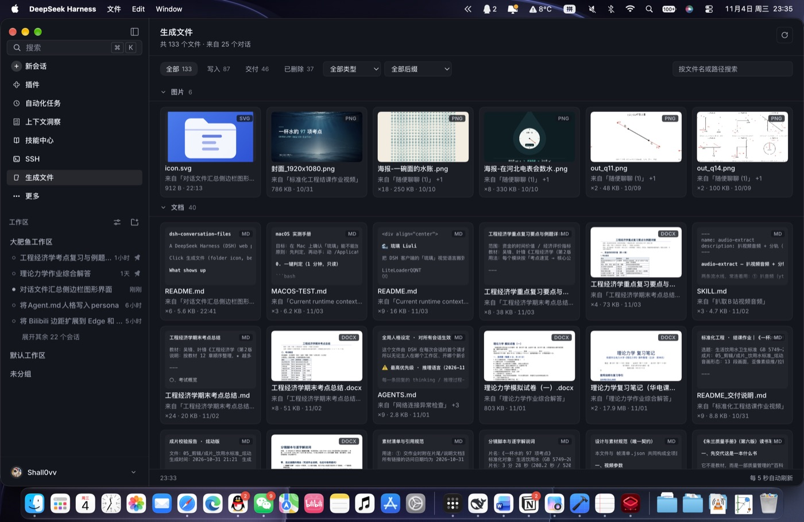
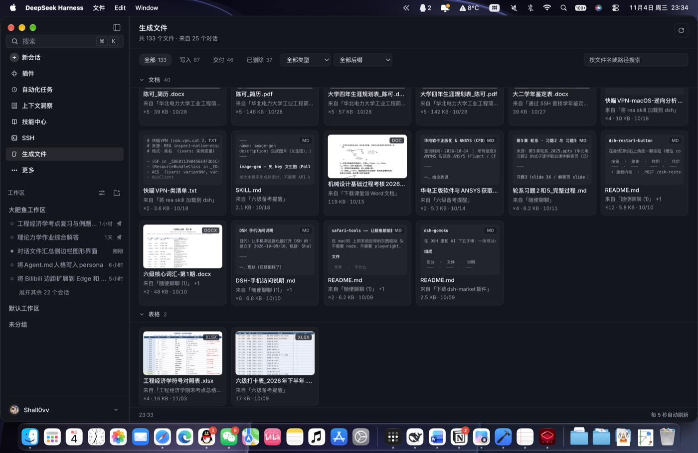
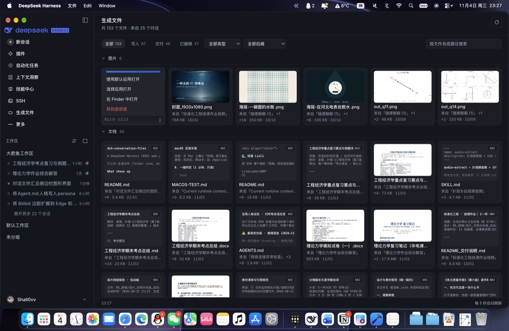

# dsh-conversation-files（对话文件）

一个 DeepSeek Harness（DSH）Web 插件：在左侧栏加一个入口，把**所有对话里助手为你生成过的文件**汇总成一个画廊面板，按文件类型分组。

点击左栏的「对话文件」（文件夹图标，在 SSH 下方）打开面板。

> English version: [README.md](./README.md)

## 面板里有什么

面板会重放当前 profile 里每个对话的事件日志，只保留助手**产出**的文件：

| 类别 | 来源 |
| --- | --- |
| 写入 / Written | 被 `write`、`edit`、`apply_patch` 等工具写入、修改或打补丁的文件 |
| 交付 / Delivered | 由 `present` 类工具主动交付给用户的文件 |

只读操作（`read`、`view_image` 等）和用户上传的附件**不算**生成文件，不会出现在这里。

文件按扩展名分组：

| 分组 | 扩展名 |
| --- | --- |
| 图片 | png jpg jpeg webp gif svg bmp avif ico |
| 文档 | md mdx txt rtf pdf doc docx docm dot dotx odt pages epub |
| 表格 | xls xlsx xlsm xlsb numbers ods csv tsv |
| 演示文稿 | ppt pptx pptm pps ppsx pot potx key odp |
| 代码 | js mjs cjs ts tsx jsx py rb go rs java kt c cc cpp h hpp cs swift sh bash zsh ps1 css scss less html htm vue lua php |
| 配置 | json jsonc json5 yaml yml toml ini conf cfg env gitignore plist lock |
| 数据 | jsonl ndjson xml parquet sqlite db sql |
| 压缩包 | zip tar gz tgz bz2 xz 7z rar dmg iso |
| 音视频 | mp3 wav m4a flac aac ogg opus mp4 mov mkv webm avi |
| 其他 | 其余全部（如 ttf woff） |

每张卡片都带**缩略图**：

| 卡片类型 | 缩略图 |
| --- | --- |
| 图片 | 图片本身，由浏览器缩放显示 |
| 代码 / 文本 / 配置 | 文件前 8 行，等宽小字，底部渐隐 |
| Markdown | 同上，但会去掉标题符号、列表符号和强调标记，读起来像正文 |
| PDF / Word / PowerPoint / Excel / iWork | 首页，按需由 macOS QuickLook 渲染 |
| 其他（压缩包、音视频、二进制） | 大号扩展名 + 类型图标 |

每张卡片右上角显示扩展名，并显示来源对话（多个对话碰过时带 `+N`）、写入次数、文件大小和最后写入时间；完整路径在悬停提示里。

**点击卡片 = 用系统默认应用打开该文件。** 右下角 ⋮ 按钮会弹出菜单（开合都有动画）：

| 菜单项 | 行为 |
| --- | --- |
| 使用默认应用打开 | 交给 `open` 用默认程序打开 |
| 选择应用打开 | 展开二级菜单，列出系统能打开这个文件的应用（默认应用排第一，末尾是「其他应用…」）。 |
| 在 Finder 中打开 | `open -R` 定位到文件 |
| 移到废纸篓 | 确认后移入 `~/.Trash`，可从废纸篓恢复 |

硬盘上已经不存在的文件**不会**混进「全部」：它们有独立的「已删除」分类、红色「已删除」标记，也不显示缩略图。

交互：

- **折叠分组** —— 点组头即可，网格带过渡动画收起；折叠状态记录在 `localStorage`。
- **按类别筛选** —— chips：全部（现存文件）/ 写入 / 交付 / 已删除。
- **按类型筛选** —— 工具栏的「全部类型」下拉，可切到某一分组（带实时计数）。
- **按后缀筛选** —— 工具栏的「全部后缀」下拉只列出**当前类型下**实际出现过的后缀（选「文档」时只剩 md/docx/pdf…），按数量从多到少排列；切换类型后若原来选的后缀已不存在，会自动退回「全部后缀」。
- **搜索** —— 按文件名或完整路径过滤。
- **切换视图** —— 工具栏右侧的「网格 / 列表」按钮在卡片网格和紧凑列表之间切换（列表行含缩略图、文件名、来源对话·写入次数·大小·日期、类型徽章、⋮ 菜单），选择记在 `localStorage`。
- 切换视图、切换全部/写入/交付/已删除、切换类型、切换后缀时，都会重播交错的**展开动画**（网格卡片从 `scale(.92)` 弹出、列表行从压扁的横条展开，逐项错开 14ms）。
- 分组头在滚动时吸顶；面板每 5 秒刷新一次（窗口隐藏时跳过）。

## 工作原理

- **Host 端**（`lib/index.js`）
  - `GET /dsh-conversation-files/generated` —— `sessionQuery.listSessions()` 列出全部会话 → 跳过 `origin: 'subagent'` → 用 `readTitleSnapshots` 批量取标题 → 逐个读日志（内存中的会话直接读，持久化的用 `readSession` 重放）→ 只解析 `tool/call` 的参数（**不**看 `tool/result`，那里的 `meta.path` 是「被操作的对象」而不是「产出」）→ 用 `realpathSync` 归一化路径 → 跨对话按路径合并 → 对前 400 个 `stat` → 按最后写入时间倒序。
  - `GET /dsh-conversation-files/thumb?path=…` —— 仅对最近一次扫描中出现过、且是图片扩展名、且 ≤ 12 MB 的文件返回图片字节。
  - `GET /dsh-conversation-files/text?path=…` —— 生成文件的前 40 行文本（≤ 256 KB，二进制文件拒绝），用于代码/Markdown 缩略图。
  - `GET /dsh-conversation-files/preview?path=…&size=…` —— 生成文档的页面缩略图，用 `qlmanage -t` 渲染，缓存在 `~/.dsh/cache/dsh-conversation-files/previews/`（每个文件一张 PNG + 一个记录 `{mtimeMs,size}` 的 JSON，用于判断是否过期），进程内还有一层内存缓存。
  - `GET /dsh-conversation-files/raw?path=…` —— 原始字节（图片、PDF、音视频），供插件内查看器使用。
  - `GET /dsh-conversation-files/apps?path=…` —— 列出能打开这个文件的应用（JXA 调 `NSWorkspace.URLsForApplicationsToOpenURL`，默认应用排第一），按扩展名缓 10 分钟。
  - `POST /dsh-conversation-files/open`、`/open-with`（可带 `app=` 指定应用，也可不带走系统选择器）、`/reveal`、`/trash` —— 卡片动作，每一个都会先拿路径去当前快照里校验。
  - 所有路由都通过 `connection.requestRejection` 拦截跨站请求。
- **Client 端**（`client/client.js`）—— 注册 `sidebar.panellist`（id `conversation-files`，order 50）和与之对应的 `main` 面板；轮询上面的路由，按 `group` 分桶，渲染吸顶分组头 + 自适应卡片网格。

缓存分三层，所以面板基本不会卡在加载页：

1. 单个会话的解析结果（内存会话按序号缓存，持久化会话缓存 60 秒）。
2. 完整快照落盘到 `~/.dsh/cache/dsh-conversation-files/generated.json`：10 分钟内的快照直接返回；一天内的先返回旧数据再后台重建（页脚显示「后台更新中」）。
3. 面板在内存里保留上一次的数据，切走再切回来可以立刻渲染。

Host 启动 5 秒后会预热扫一次，所以即使进程刚冷启动，点开侧栏时快照也已经就绪。

## 截图





## 已知限制

- 通过 `bash` 重定向（`>`、`tee` 等）写出的文件是看不见的 —— 那不是结构化写入调用，只有工具参数会被解析。
- `.conf` / `.lock` 这类扩展名落到「配置」；未知扩展名（字体、二进制等）落到「其他」。

## 安装

```sh
git clone https://github.com/Shall0vv/dsh-conversation-files
```

然后在 DSH 里：

```
plugin_manager install_bundle target=<克隆下来的目录的绝对路径>
```

更新已安装的版本，先移除再装：

```
plugin_manager remove_bundle  target=dsh-conversation-files
plugin_manager install_bundle target=<克隆下来的目录的绝对路径>
```

bundle 以 link 形式挂到 `~/.dsh/profiles/<profile>/package.json`，并登记在 `dsh.profile.bundles` 里，重启后依然生效。从 profile 里移除这个 bundle，侧栏入口也就消失了。

### 运行要求

- macOS：QuickLook 缩略图（`qlmanage`）、移到废纸篓（`~/.Trash`）、应用列表与选择应用打开（`osascript` + `NSWorkspace`）用的是系统能力；画廊本身、文本缩略图、筛选在任何平台都能用。
- DSH 需要带 `web` 客户端，没有额外依赖。
